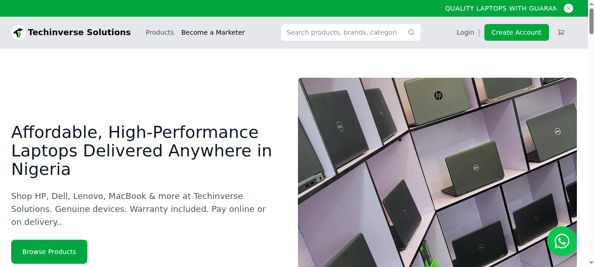

# Techinverse Solutions — Tech Retail Store

A laptop and tech retail store built for nationwide delivery in Nigeria — brand filtering, pay-on-delivery and a marketer programme with commission tracking.

**[→ View the live site](https://techinverse-solutions.vercel.app/)**



## What this is

An online store for a Nigerian tech retailer. The hard part wasn't the product pages — it was trust. Customers buying a laptop online want to know the warranty terms, the payment options and whether the thing will actually arrive.

So the build puts those answers up front: warranty and payment terms on every product page, pay-on-delivery as a first-class option, and a marketer programme with its own sign-up and commission tracking so the sales team can grow the business without a spreadsheet.

## What's inside

- Product catalogue with brand filtering
- Product pages with warranty and payment terms
- Pay-on-delivery checkout
- Marketer programme with sign-up and commission tracking
- 55 pages, fully self-contained static build

## Technology

- HTML, CSS and JavaScript
- Static site — no build step required
- Deployed on Vercel and GitHub Pages

## Run it locally

No build step, no dependencies — it's plain HTML, CSS and JavaScript.

```bash
# from the repository root
python3 -m http.server 8000
# then open http://localhost:8000
```

Or just open `index.html` directly in a browser.


---

<sub>Built by **[Benito K Chukwuemeka](https://github.com/Ebubechineka)** · [Golden Vista Global](https://ebubechineka.github.io/golden-vista-global/) — business websites, landing pages and web apps for clients in Nigeria and worldwide.</sub>
